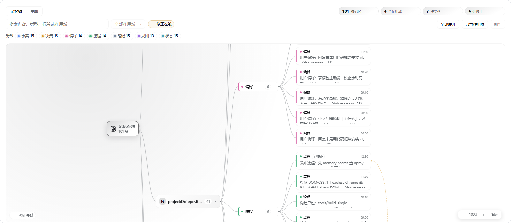

<div align="center">

# DSH 记忆系统

**给 DeepSeek Harness 的本地优先长期记忆插件：多路检索 + 多跳图增强 + 上下文摘要 + 冲突消解**

[](https://github.com/HANPU5838/dsh-memory/releases)
[](LICENSE)
[](package.json)

**[安装](#快速开始) · [能力](#它为什么是真正的记忆系统) · [配置](#配置参考) · [评测](#评测与验收) · [更新日志](CHANGELOG.md)**

</div>

**当前版本：v0.100.0** · [Release](https://github.com/HANPU5838/dsh-memory/releases) · [更新日志](CHANGELOG.md)

---

> **本仓库是 DSH 记忆系统的独立维护版，也是唯一维护源。**
> 代码、Release、Issue、安装与更新都只认 `HANPU5838/dsh-memory`；包名 `@restregular/dsh-memory`
> 只是为了兼容 DSH 的 Loader entry。原作者与 MIT 版权声明完整保留（见 [LICENSE](LICENSE) 与文末致谢）。

## 这是什么

DSH 记忆系统是一个**完全本地**的长期记忆插件：Agent 用八个工具读写记忆，插件在每一轮把相关记忆
检索出来、压缩成上下文注入；记忆本身有强度、会衰减、会巩固、会裁决冲突，而不是一堆只进不出的文本。

- **数据在本机**：默认 `~/.dsh-memory`（JSONL + 向量缓存），不依赖任何云服务。
- **零配置可用**：不装向量后端就自动退化为纯词法检索，不产生网络请求。
- **语义检索可选**：面板一键安装 llama.cpp 运行时 + bge-m3 模型（或接你自己的 OpenAI 兼容端点）。
- **可解释**：检索结果带来源标记（词法/向量/图增强/联想）——**工具输出也会把图增强补召回标成
  「联想」**（0.94.0），并由端到端测试保证 provider→工具→渲染全链路一致（0.95.0），模型能区分
  直接命中与多跳联想；面板「审计」能看每次注入的完整决策链。

| 场景 | 用法 |
| --- | --- |
| Agent 记住偏好 / 事实 / 流程 / 决策 | `memory_save` 写入；下次相关任务自动召回 |
| 主动查历史结论 | `memory_search` 只回印象，需要正文再 `memory_get` |
| 多项目 / 多会话隔离 | `global` / `project:` / `session:` / 自定义作用域，按作用域授权 |
| 大库管理 | 面板记录页、知识树、关系分析、审计、备份恢复、导入导出 |
| 让别的插件感知记忆变化 | 订阅 `memory/record-saved` / `recalled` / `record-forgotten` / `consolidated` |

## 它为什么是“真正的记忆系统”

不是把所有东西塞进向量库就完事。这个插件把「记忆」拆成四个互相约束的层：

```
写入层   作用域 / 类型 / 重要度 / 标签 / 有效期 / 密钥脱敏
   ↓
检索层   词法(BM25) + 向量(bge-m3) + 图增强(PPR 多跳) + PRF 查询扩展 → RRF 融合
   ↓
上下文层 动态 token 预算 → TextRank 摘要 → 冲突消解 → 注入
   ↓
生命周期 强度(FSRS)/保持度 → 语义合并 → 冲突裁决 → 周期巩固 → 休眠/软删
```

每一层都有对应的评测和回归测试（见 [评测与验收](#评测与验收)），默认值尽量由数据决定，而不是拍脑袋。

### 检索：多路召回，各管各的

| 通道 | 作用 |
| --- | --- |
| **词法 BM25** | 精确 token、代码标识符、路径、版本号的强命中 |
| **向量 bge-m3** | 换个说法也能找到（语义相似） |
| **图增强多跳（PPR）** | 记忆之间共享实体（路径/URL/版本/标签）时互相桥接，补召回「字面搜不到」的相关记忆 |
| **PRF 查询扩展** | 无向量时也能用首轮命中记忆自己的措辞补全查询（如「上线失败」→ `deploy.sh --dry-run`） |
| **RRF 融合** | 多路结果按排名融合，只做排序加成，不覆盖相关度 |

补充设计：

- 图增强预算自适应（0.86.0）：结果已满 topK 时**最多补 2 条**；记录数 < 4×`minRecords` 的小库
  **最多补 3 条、门槛 +50%、种子 ≤4**——避免小库上联想噪声稀释真命中；
- 图增强只用**当前可见**记录建图（屏蔽/归档/过期/类型过滤全部继承），补召回候选拿合成低分，不压过真命中；
- 边权按实体类型区分：共享路径/URL/版本号（具体对象）比共享泛标签更可信；社区检测（标签传播）给补充候
  选加**同社区限流**，避免单一热门主题刷屏；
- 实体先做归一化：`/srv//app`、`\srv\app\`、`/srv/app/` 是同一个 path；`Deploy`=`deploy`；`v1.2.3`=`1.2.3`；
- PRF 只在首轮候选稀疏（≤2 条）时触发，并只选 df≤3 的稀有共现词，防止扩大噪声；
- 分词与实体提取按记录缓存（0.91.0，`updatedAt` + 内容长度失效）：1200 条库实测检索
  图关 75→31ms、图开 181→121ms；100/400 条分别约 5/13ms（图关）与 6/21ms（图开）。

### 上下文：预算 + 摘要 + 冲突消解

- **动态预算**：每条记忆的字数按它和本轮最高分的相对相关度伸缩（高相关 0.55×–1.30×，低相关收紧，
  下限 48 字），总 token 预算不变；
- **抽取式摘要（TextRank）**：长记忆不再只截开头 N 字，而是先切句、做近重复去重、算句子中心性、
  再按查询相关性加权，最后选信息量最高的句子（只抽原文，不编造）。**0.87.0 起 L1 会话摘要
  （新会话概览）也走同一内核**——上下文只保留一套摘要实现，不再"召回是摘要、摘要是截断"；
- **冲突消解**：同一轮召回里互相矛盾的记忆（`conflictWith`）只保留重要度更高 → 更新的一条，
  败者不进上下文（记录保留不删，审计记为 `reason=conflict`）；
- **可解释标记**：图增强补召回的结果带 `graphExpanded: true`，**工具输出与注入正文都会标「联想」**
  （0.94/0.96）；注入审计能看到候选/过滤/省略/预算。

### 生命周期：会衰减、会巩固、会遗忘

- **强度排序（FSRS 式）**：相关度 × 保持度（retention）× 效用提升（utility）× 重要度 × 退役惩罚，
  排序过程可解释（面板/日志能看每个因子）；
- **事实时间权重**：新近更新加权、临近失效减权；
- **语义合并**：写入时近重复（余弦 ≥0.92 且关键细节一致）自动合并，旧版本经 `supersedes` 保留可溯源；
- **冲突裁决**：0.75–0.92 或数字/路径/标识符不一致先打冲突标记，再按矛盾度 + 证据 + 来源 + 时间自动裁决；
- **周期巩固**：同作用域、高相似的活跃记忆做抽取式合并（基底 + 簇内独有要点），产物带 `consolidated`
  语义标记并发 `memory/consolidated` 事件；冲突/退役/休眠/失效记录不参与。**0.88.0 起没有向量也能巩固**：
  向量缺失时用 token Dice 相似度保守聚类（`cognitive.consolidation.lexicalFallback`，默认开、
  阈值 0.8）——纯词法部署不再"永不巩固"；
- **语义层偏好**：巩固产物在相关度接近时优先于原始记录（`retrieval.semanticLayerBoost`，默认 0.04）；
- **休眠 / 软删 / 恢复**：低重要度长期不用会休眠；删除走软删（可恢复），30 天后才物理清理。

### 组织：作用域、屏蔽、归档、规则代码

| 能力 | 说明 |
| --- | --- |
| 作用域 | `global`（全局）/ `project:<工作区>` / `session:<会话>` / 自定义（如 `handbook`）；每个作用域可写「用途」和别名 |
| 权限与审批 | 会话级记忆权限（绝对限制/普通限制/无限制）；范围外读写走审批；审批来自用户，不来自 Agent |
| 主动屏蔽 | `memory_block` 把无关记忆**藏起来**而非删掉：会话级/工作区级，按作用域或记录 id；可逆 |
| 作用域归档 | 会话/项目归档后冻结读写、退出检索；重新加入自动解冻 |
| 规则代码钩子 | `kind=rule` 的记忆可附带脚本（保存前校验 / 保存后观察 / 注入前解析），代码在面板逐行审查后才能启用 |
| 事件 | 写入/召回/删除/巩固四类旁路事件（只带元数据，绝不含正文），其他插件可订阅 |

## 八个工具

| 工具 | 用途 |
| --- | --- |
| `memory_save` | 写入一条记忆（内容 / 作用域 / 类型 / 标签 / 重要度 / 有效期 / 触发词） |
| `memory_search` | 检索：只回印象（8 位 id / 作用域 / 类型 / 标签 / 短摘要），需要正文用 `get` |
| `memory_list` | 按作用域 / 类型列出记忆 |
| `memory_get` | 取正文与元数据（`fields` 按需选择；同一会话已出现过的条目只回 id） |
| `memory_forget` | 删除（软删/物理删按参数，规则与作用域受审批保护） |
| `memory_scopes` | 作用域目录：`list` / `edit`（用途、别名）/ `request`（申请范围外权限） |
| `memory_block` | 主动屏蔽：`block` / `unblock` / `list`（会话级或工作区级） |
| `memory_hooks` | 规则代码钩子：`list` / `get` / `save` / `delete` / `approve` / `enable` / `disable` / `run`（试跑不写记忆） |

## 面板

侧栏/插件面板打开「记忆系统」，七个标签页：

- **服务**：向量后端状态、环境自检、一键安装运行时/模型、记忆健康度；
- **记录**：记忆 / 作用域两个子标签，浏览、搜索、语义检索、新建/编辑（生成修正版）、删除、导入导出；
- **记忆图**：**知识树**（作用域 → 类型 → 记录，含修正关系连线；支持搜索/筛选/缩放/详情抽屉）；
- **关系分析**：潜在关系发现、冲突检测、知识聚类、演化时间线（带证据，推断与事实分离）；
- **规则代码**：规则附带的脚本审查、启用/禁用、试跑；这里是**唯一**能看/改代码的地方；
- **设置**：召回/摘要/印象/策略/规则/自动召回/图增强/动态预算逐项开关，改完即存 `settings.json`；
- **审计**：每次注入的触发原因、候选、过滤、省略、预算、投递状态，可定位到会话轨迹。





## 快速开始

要求：**DSH + Node ≥ 22.13**。插件通过 GitHub 安装，不依赖 npm 发布。

### 安装

```bash
dsh plugin --profile web add "github:HANPU5838/dsh-memory#main"
```

或者用面板的插件管理器：添加 bundle → `github:HANPU5838/dsh-memory`。

### 更新到最新版（只走本仓库）

```bash
dsh plugin --profile web remove @restregular/dsh-memory
dsh plugin --profile web add "github:HANPU5838/dsh-memory#main"
```

面板插件管理器同理：先移除 `@restregular/dsh-memory`，再安装上面的 GitHub 地址。升级不会动
`~/.dsh-memory` 里的记忆数据。

### 零配置使用

不写任何配置就能用：检索退化为词法，不联网。要继续用语义检索，在面板「服务 → 向量服务」点一键安装即可
（Termux/Android 走 `pkg install llama-cpp` + 只下模型；Linux/macOS/Windows 下载托管运行时 + 模型）。
默认自动检测本机已有 llama-server / Ollama / LM Studio 等兼容端点，可用时零下载直接采用。

### 最小配置（可选）

把下面的键放在插件 entry 的 `config` 里（宿主 cordis 配置；运行时开关也可以在面板改）：

```yaml
config:
  storeDir: '~/.dsh-memory'
  scopes:
    global: true
    project: true
    session: true
    custom: { enabled: true, max: 200 }
  retrieval:
    topK: 5
    recallN: 30
    vector:
      enabled: true
      autoBootstrap: auto        # auto | off | always
    lexicalPrf: { enabled: true, maxTerms: 2 }          # 词法查询扩展
    graphExpansion: { enabled: true, maxPerCommunity: 3 } # 图增强多跳 + 社区限流
    semanticLayerBoost: 0.04     # 巩固产物优先（0 = 关闭）
  cognitive:
    merge: { enabled: true, threshold: 0.92 }
    conflict: { enabled: true, minSimilarity: 0.75 }
    consolidation: { enabled: true, threshold: 0.9 }
  limits: { maxRecordsPerScope: 2000, maxRecordChars: 4000 }
  secrets: { enabled: true, mode: refuse }   # refuse | redact
```

## 配置参考（常用项）

| 键 | 默认 | 说明 |
| --- | --- | --- |
| `storeDir` | `~/.dsh-memory` | 记忆库根目录（JSONL + 向量缓存 + 备份） |
| `scopes.*` | 全开 | 关闭某类作用域后对应写入返回 `SCOPE_DISABLED` |
| `retrieval.topK` / `recallN` | 5 / 30 | 注入条数 / 候选召回深度 |
| `retrieval.vector.provider` | `local` | `local`（llama-server）/ `openai` / `ollama` / `off` |
| `retrieval.vector.endpoint` | `127.0.0.1:8078/v1/embeddings` | 兼容 OpenAI `/v1/embeddings` |
| `retrieval.vector.ann.enabled` | `false` | 大库（>2000 条/作用域）再开 HNSW |
| `retrieval.llm.enabled` | `false` | 可选 LLM 重排（调用你自己的模型端点） |
| `retrieval.lexicalPrf.enabled` | `true` | 词法伪相关反馈（候选 ≤2 时触发） |
| `retrieval.graphExpansion.enabled` | `true` | 图增强多跳召回 |
| `retrieval.semanticLayerBoost` | `0.04` | 巩固产物优先系数（0–0.2） |
| `retrieval.strengthRanking` | `true` | FSRS 强度排序（false 回退旧公式） |
| `retrieval.temporalWeighting` | `true` | 事实时间权重 |
| `cognitive.consolidation.lexicalFallback` | `true` | 无向量时的词法巩固兜底（Dice 阈值 0.8） |
| `cognitive.lifecycle` | 30 天 | 休眠/软删周期 |
| `inject.recall.tokenBudget` | 500 | 每轮召回注入 token 预算 |
| `inject.impression.chars` / `dynamic` | 120 / true | 每条印象字数 / 按相关度动态分配 |
| `limits.maxRecordsPerScope` | 2000 | 单作用域容量上限（淘汰最弱） |
| `secrets.mode` | `refuse` | 命中凭据时拒绝写入或 `redact` 脱敏 |

面板「设置」里能改的项会写入 `<storeDir>/settings.json`，优先级高于配置文件；删掉 `settings.json`
里的对应小节即回到配置值。

## 评测与验收

### 真实库全链路验收

```bash
npm run e2e:real                  # 复制 ~/.dsh-memory 到临时目录，跑检索/注入/doctor 后删除副本
npm run e2e:real -- --store /path # 指定其它库
```

证明「代码通过」与「这台机器的真实数据能用」是同一件事：复制真实库 → 加载真实作用域 →
抽样真实内容检索 → 渲染注入块并跑一次 MemoryInjector → 对副本跑 doctor；**不修改线上数据**。
本机实测：**71 条记录 / 5 条查询 25 条命中 / 注入 4 行 / doctor PASS**。

### 一键体检真实记忆库

```bash
npm run doctor                  # 体检 ~/.dsh-memory
npm run doctor -- --store /path # 指定其它库
```

只读检查，逐项报告：目录/JSONL 完整性（坏行会 FAIL）、settings.json 可解析与新键齐全、
健康度分数、冲突中心、规则代码（含待审批钩子）、向量服务可达性、备份数量；退出码在有数据损坏时为 1。
本机实测：**10 ok / 0 warn / 0 fail（PASS）**。

### 文档一致性守门

```bash
npm run check:docs   # 版本 / badge / CHANGELOG / IMPROVEMENTS / 文档链接 / build 版本
```

在任何一次发版前，保证 README 徽章、package.json、CHANGELOG 顶部条目、architecture 标题完全同步；
`npm test` 与 CI 都会跑它，漂移会直接失败。

### 一条命令验收

```bash
npm run verify:all
```

四层：全量测试 → 单包构建 → 面板 API 冒烟（16 接口）→ 向量后端实测（没有后端时 SKIP 不算失败）。
失败退出码非 0，可直接当 pre-push hook / CI 步骤。

当前状态（0.84.0）：**1274 例 / 1273 pass / 1 skip / 0 fail**，验收集成 87 文件（约 2.4 MiB），
面板 API 16/16，向量后端实测通过。

### 检索质量评测（本地、确定性、进 CI）

| 脚本 | 测什么 | 参考结果 |
| --- | --- | --- |
| `npm run eval:graph` | 图增强多跳：合成「实体桥接」语料对比开关 | 桥接召回 **0% → 100%**，平均无关记录 0.00 |
| `npm run eval:tune` | 参数扫描：图权重/种子数/门槛/语义层 boost/PRF，单因子扫描；含 18 条小库场景 + **设置开关对比** | 默认值区间内桥接/精确/巩固/PRF 均 100%，无关命中率 42.9%；小库图关 0%→开 100%；设置：图增强关闭桥接 100%→0%，动态预算最高行 156 字 vs 固定 130 |
| `npm run eval:summarize` | 召回摘要：关键结论都在正文后半段，对比前缀截断 vs TextRank | 关键结论保留 **0% → 100%**，平均输出字数 80 → 67.5 |

三个脚本都是纯本地、确定性、秒级、退出码恒 0（用于观察与回归），CI 每次 push 都会跑。
更详细的方法与口径见 [docs/verification.md](docs/verification.md)。

## 架构与文档

| 文档 | 内容 |
| --- | --- |
| [docs/architecture.md](docs/architecture.md) | 模块划分、数据布局、检索/注入/认知层管线 |
| [docs/verification.md](docs/verification.md) | 三层验收：自动验收、真机功能清单、排障手册 |
| [docs/analysis.md](docs/analysis.md) | 关系分析（关系发现/冲突/聚类/时间线）设计与证据口径 |
| [docs/comparison.md](docs/comparison.md) | 与 Mem0 / Zep / Letta / Cognee 等记忆系统的对照 |
| [docs/benchmark.md](docs/benchmark.md) | 性能基准方法（存储、检索、嵌入吞吐） |
| [CHANGELOG.md](CHANGELOG.md) | 逐版本变更记录 |

实现上是一个包 + 一条 Loader entry，四个半边（provider / tools / inject / panel）组合在
`lib/index.js`，任何一半失败都只记日志、绝不让 DSH 启动失败。

## 数据与隐私

- 记忆、向量缓存、备份全部在 `<storeDir>` 下；不配置向量后端时**零网络请求**；
- 写入时默认拒绝保存疑似凭据（API key/token/密码），可改为 `redact` 脱敏后保存；识别覆盖
  `sk-`/GitHub/AWS/Slack/Bearer/私钥、**JWT、HuggingFace、Google API、Stripe、npm、Basic-Auth 连接串、
  Telegram bot token 与中文「密码/令牌：…」表述**（0.90.0 补齐）；
- 范围外访问需要用户审批（会话级权限 + 审批卡），Agent 不能绕过；
- `memory_block` 是“隐藏”不是删除；软删记录可在 30 天内恢复；
- 升级插件只替换代码，不迁移/不重写记忆数据。

## 常见问题

**插件列表里显示包名，没有“记忆系统”？**
确认版本 ≥ 0.11.0 且包里有 `locale/`；宿主会缓存 `exports`，更新后重启一次 DSH。

**没有自动召回？**
检查 `inject.recall` / `autoRecall` 是否开启、当前作用域是否在召回范围；在面板「审计」里按会话看
触发原因、候选与省略原因。

**向量服务装不上 / 一直 SKIP？**
面板「服务 → 环境自检」逐项看：运行时、glibc/bionic、磁盘、模型；Termux 用 `pkg install llama-cpp`，
桌面端可用一键托管安装；也可以配 `endpoint` 指向你自己的兼容端点。

**数据怎么备份？**
复制整个 `<storeDir>`；或用面板「设置 → 导出」（导入会按当前模型重新嵌入，不携带旧向量）。

**改了设置没生效？**
`settings.json` 优先级高于配置文件；面板改完是即时生效的，进程重启也会保留。

## 版本与发布

本仓库用 **tag + GitHub Release** 发布（不向 npm 发布）：推送 `v*` tag 后
`.github/workflows/release.yml` 自动从 [CHANGELOG.md](CHANGELOG.md) 提取对应版本段落创建 Release。
当前最新：**v0.84.0** —— 记录卡预览两行 clamp（UI 收尾）；v0.83.0 注入前冲突消解；
v0.82.0 图增强（类型边权 + 社区限流）；v0.81.0 召回 TextRank 摘要；v0.80.0 词法 PRF；
v0.79.0 记录卡长作用域 UI 修复。

## 致谢与许可

- **原作者**：RestRegular（原始项目 [RestRegular/dsh-memory](https://github.com/RestRegular/dsh-memory)，MIT）。
  本项目在其基础上独立维护，MIT 版权与署名完整保留（[LICENSE](LICENSE)）。
- **当前维护**：[HANPU5838/dsh-memory](https://github.com/HANPU5838/dsh-memory)。
- 本机向量检索由 [llama.cpp](https://github.com/ggml-org/llama.cpp) + bge-m3 提供。

MIT License © RestRegular（原始版权）与 HANPU5838（本仓库维护）
